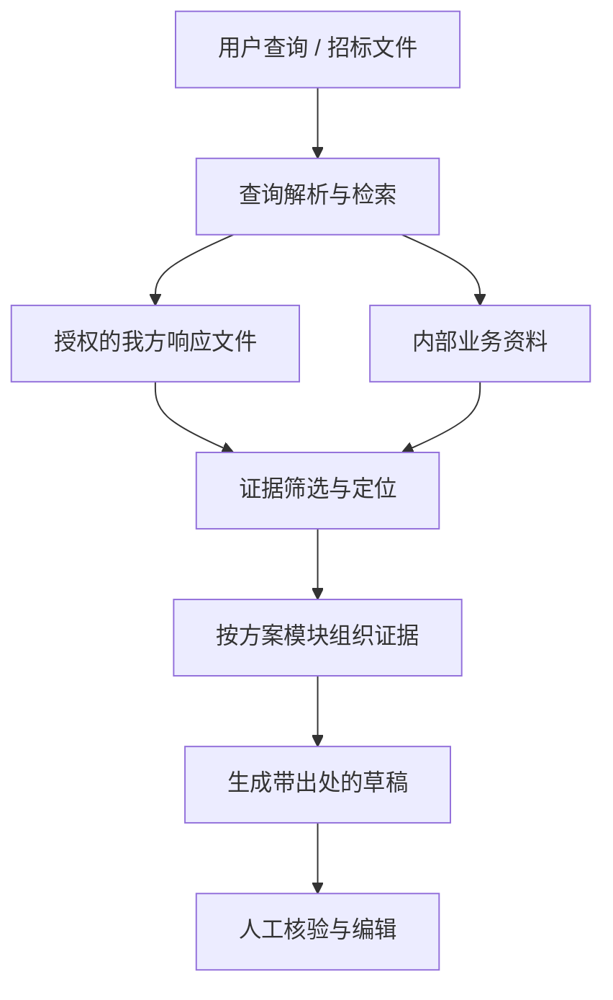

# Bid AI Clean

<p align="center">
  <strong>面向投标资料的智能检索与证据约束方案生成</strong>
</p>

<p align="center">
  
  
  
  
</p>

Bid AI Clean 聚焦投标工作的两条核心链路：**历史材料定位**与**模块级方案生成**。系统从经过授权的历史响应文件和内部业务资料中检索证据，返回可追溯的材料位置，并将证据作为生成边界，辅助形成可供业务人员复核的方案草稿。

## 核心功能

### 历史材料定位

- 使用自然语言描述需要查找的材料。
- 从授权的我方响应文件与业务资料中检索相关证据。
- 支持合同产品与金额、财务/社保月份、仪器设备和方案章节等材料类型。
- 返回文件定位信息，方便用户打开原始材料核对。

### 模块级方案生成

- 围绕方案模块检索历史我方材料。
- 将检索证据组织为生成上下文。
- 生成带出处的模块级草稿，便于人工复核和继续编辑。
- 对证据不足、来源冲突或无法确认的内容保留明确边界，不把推测写成我方承诺。

## 检索与证据边界



方案生成遵循“先定位证据，再组织草稿”的原则。招标要求、竞品内容、空模板或来源不明的信息不能直接当作我方能力或承诺；关键数字发生冲突时应保留来源差异，交由业务人员核对。

## 技术栈

- Python 3.11+
- FastAPI
- Elasticsearch 8.x
- 关键词与语义混合检索
- Pytest

具体依赖以 [requirements.txt](requirements.txt) 为准。

## 快速开始

### 环境准备

- Python 3.11+
- Elasticsearch 8.x（检索功能需要）
- 已授权且可访问的资料目录或准备好的索引数据
- 如启用模型能力，需配置对应模型服务凭证

### 安装

```bash
git clone https://github.com/SuperGh2233/bid-knowledge.git
cd bid-knowledge

python -m venv .venv
source .venv/bin/activate
python -m pip install -r requirements.txt
```

Windows PowerShell 激活虚拟环境：

```powershell
.venv\Scripts\Activate.ps1
```

### 配置

```bash
cp .env.example .env
```

根据自己的部署环境配置数据库、Elasticsearch 和模型服务参数。变量说明以 [.env.example](.env.example) 和项目配置代码为准。

**不要提交真实 API Key、密码、内网地址、业务文件、客户数据或生产数据库。** 共享资料目录应按授权范围接入，建议先使用只读挂载。

### 启动

```bash
python -m app.api
```

默认本地 API 地址：<http://127.0.0.1:8000>

## 测试与评测

```bash
pytest tests -q
python scripts/eval_gold_recall.py
```

检索指标受语料版本、索引状态、查询集和检索参数影响。历史评测报告应结合对应的数据版本阅读，不应将小样本结果直接解释为生产环境效果。

## 项目结构

```text
.
├── app/          # API、检索、解析与方案生成
├── static/       # 静态 Web 页面
├── scripts/      # 数据处理、索引刷新与评测脚本
├── tests/        # 自动化测试
├── docs/         # 设计、评测、计划与交接文档
├── .env.example  # 环境变量模板
└── requirements.txt
```

## 文档

- [文档索引](docs/index.md)
- [项目交接说明](docs/agent-handoff.md)
- [评测记录](docs/evals/)
- [授权与数据使用说明](docs/authorizations/)

## 安全与使用边界

- 仅接入获得授权的资料源；不要将公司内网目录、客户文件或凭证公开到 GitHub。
- 模型外发范围应遵循项目授权记录和部署策略。
- 生成内容是辅助草稿，正式投标前必须人工核对出处、数字和承诺。
- 生产部署前应完成身份认证、权限隔离、日志脱敏、数据备份和目标环境验收。

## License

请以仓库中的 LICENSE 文件为准；如仓库未提供 LICENSE，请不要默认其内容可自由再分发或商用。
